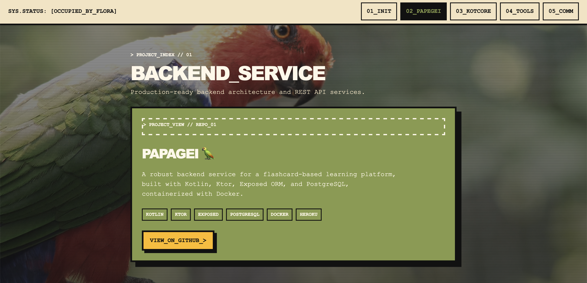

# zghoba.space

[](https://zghoba.space)
[](https://astro.build/)
[](https://nodejs.org/)
[](https://zghoba.space/)

zghoba.space is Yaroslav Zghoba's personal developer portfolio, focused on Kotlin, backend engineering, and Kotlin Multiplatform. It presents selected projects, technical interests, professional status, and ways to get in touch through a single interactive site.



This repository contains the Astro source for the website, including localized page content, shared layouts and components, global styling, client-side navigation behavior, and static assets.

## 🚀 Project overview

- **Multilingual portfolio** — English, German, and Ukrainian routes are available at `/`, `/de/`, and `/ua/`.
- **Localized content model** — translated copy is kept in separate JSON locale files while the page structure is shared through one Astro template.
- **Project showcase** — highlights backend services, a Kotlin Multiplatform 2D engine, CI/CD tooling, and a browser-based color utility.
- **Focused single-page experience** — section-based navigation keeps the profile, projects, and contact information connected in one scrollable interface.
- **Responsive visual system** — custom styles and the `sys.override` design system provide the interface's cards, typography, colors, and layout.
- **Motion-aware interactions** — background media and section highlighting are controlled with browser APIs and respect `prefers-reduced-motion`.
- **Static-first delivery** — Astro builds the site into a deployable `dist/` directory without a runtime backend.

## 🗂️ Project Structure

```text
.
├── public/                 # Favicon and other static assets
├── src/
│   ├── components/         # Shared Astro page components
│   ├── layouts/            # Base document layout
│   ├── locales/            # English, German, and Ukrainian content
│   ├── pages/              # Locale entry points and routes
│   ├── scripts/            # Client-side navigation and media behavior
│   └── styles/             # Global site styles
├── astro.config.mjs        # Astro and i18n configuration
└── package.json             # Scripts, dependencies, and Node requirement
```

## ▶️ How to Run

### Requirements:

- Node.js `>=22.22.0`
- npm

Install dependencies from the repository root:

```sh
npm install
```

<details>
<summary>Option 1: Running the development version</summary>

Start Astro's development server in the background:

```sh
npm run dev -- --background
```

The site is available at [http://localhost:4321](http://localhost:4321). The server can also be managed with:

```sh
astro dev status
astro dev logs
astro dev stop
```

</details>

<details>
<summary>Option 2: Running the production version</summary>

Create the production output:

```sh
npm run build
```

Astro writes the generated site to `dist/`. To serve that build locally before deployment:

```sh
npm run preview
```

</details>

## 🔧 Available Commands

| Command | Description |
| --- | --- |
| `npm install` | Install project dependencies. |
| `npm run dev` | Start the local development server. |
| `npm run build` | Build the static production site in `dist/`. |
| `npm run preview` | Serve the production build locally. |
| `npm run astro -- --help` | Show available Astro CLI commands. |

## 🌍 Adding or Updating a Language

Add or update a JSON file in `src/locales/`, then create the corresponding page under `src/pages/`. Register the locale in `astro.config.mjs` and pass the locale object to `MainPageTemplate` so the route uses the same layout and behavior as the existing pages.
